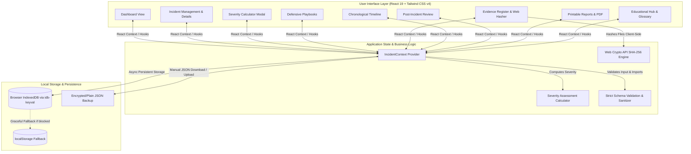

# IncidentKit — Incident Response Planner & Evidence Register

[](LICENSE)
[](https://www.typescriptlang.org/)
[](https://react.dev/)
[](https://vitejs.dev/)
[](https://tailwindcss.com/)
[](https://vitest.dev/)
[](#strict-zero-cost--privacy-architecture)
[](https://vercel.com/)

> **IncidentKit** is an offline-first, client-side cybersecurity incident response planning, evidence management, and post-incident review platform. Built as a portfolio project for computer system security undergraduates and aspiring SOC analysts / incident response engineers.

IncidentKit simulates a real-world Security Operations Center (SOC) incident response workflow aligned with **NIST SP 800-61 Rev. 2** (*Computer Security Incident Handling Guide*) and **SANS 6-Step Incident Handling**. It empowers security teams, educators, and students to document incidents, assess operational severity, follow structured defensive playbooks, calculate cryptographic hashes locally, preserve chronological timelines, and generate audit-ready incident reports.

---

## 🌟 Live Demo & Preview

- **Live Application:** Deployed on Vercel's free tier: [https://incidentkit-incident-response-planner.vercel.app](https://incidentkit-incident-response-planner.vercel.app) *(or your deployed Vercel domain)*
- **GitHub Repository:** [https://github.com/GorillaBrain/incidentkit-incident-response-planner](https://github.com/GorillaBrain/incidentkit-incident-response-planner)

---

## 🛡️ Key Features

### 1. Incident Operations Dashboard
- **Executive Metrics:** High-level overview of total incidents, active investigations, contained threats, critical/high severity distributions, and pending post-incident review follow-ups.
- **Visual Analytics:** Interactive Recharts severity breakdown charts.
- **Multifaceted Filtering:** Filter by status (`New`, `Investigating`, `Contained`, `Recovering`, `Resolved`, `Closed`), severity (`Low`, `Medium`, `High`, `Critical`), incident category, and full-text search across titles, descriptions, and tags.
- **Synthetic Demo Data:** Instant 1-click synthetic dataset loader (`INC-2026-001` through `INC-2026-005`) covering ransomware, business email compromise, malware, insider threats, and DDoS scenarios. Safe 1-click purge option to clear all demo data and start clean.

### 2. Incident Management & Lifecycle State Machine
- **Comprehensive Incident Records:** Track incident IDs (`INC-YYYY-XXX`), classifications, affected assets/hosts, suspected threat vectors, impact summaries, response leads, and resolution notes.
- **10 Core Incident Categories:** Phishing, Malware Infection, Ransomware, Unauthorized Access, Credential Compromise, Data Breach, Denial-of-Service, Suspicious Network Activity, Insider Threat, and Other.
- **Enforced Lifecycle Transitions:** State machine with validated transitions (`New` ➔ `Investigating` ➔ `Contained` ➔ `Recovering` ➔ `Resolved` ➔ `Closed`) requiring transition notes to enforce operational accountability.

### 3. Multi-Factor Severity Assessment Engine
- **NIST-Aligned 100-Point Algorithm:** Objective mathematical scoring model evaluating 6 distinct risk dimensions:
  1. Business operational impact (0–25 pts)
  2. Number of affected endpoints / user accounts (0–20 pts)
  3. Sensitivity and regulatory tier of affected data (0–20 pts)
  4. Core service availability loss (0–15 pts)
  5. Active adversary presence / ongoing C2 (0–10 pts)
  6. Lateral movement & spread velocity (0–10 pts)
- **Defensible Scoring Rationale:** Automatically generates bulleted technical justifications for the recommended tier (`Low` < 30, `Medium` 30–54, `High` 55–79, `Critical` ≥ 80).
- **Human-in-the-Loop Override:** Responders can manually override the calculated severity level while retaining full audit logs of the original calculated score and the override rationale.

### 4. Structured Defensive Playbooks
- **6 Pre-Configured Playbooks:**
  1. *Phishing & Credential Harvester Response*
  2. *Malware Infection & Endpoint Triage*
  3. *Ransomware Containment & Recovery*
  4. *Compromised Account Remediation*
  5. *Suspected Data Exfiltration / Data Breach*
  6. *Suspicious Network Activity & C2 Investigation*
- **6 Standard IR Phases per Playbook:** Preparation & Initial Assessment, Identification & Triage, Containment, Eradication, Recovery, and Post-Incident Review.
- **Defensive Safeguards:** Playbooks strictly outline defensive recommendations (log preservation, network isolation, credential revocation, forensic imaging). **IncidentKit never executes dangerous commands or modifies external infrastructure automatically.**
- **Progress Tracking:** Interactive task checklists with completion timestamps, custom responder notes, and completion progress bars.

### 5. Digital Evidence Register & In-Browser Hasher
- **RFC 3227 Compliance:** Structured evidence logging tracking Evidence IDs (`EVD-XXX`), evidence categories (disk images, system logs, memory dumps, PCAP captures, email headers, screenshots), source assets, collectors, and chain of custody.
- **Client-Side SHA-256 Hasher:** Uses the browser's native **Web Crypto API** (`window.crypto.subtle.digest`) to calculate cryptographic SHA-256 hashes of local files or text artifacts. **Files are hashed entirely in browser memory; zero bytes are ever uploaded to a server.**
- **Integrity Notice:** Explains that cryptographic hashing verifies file integrity against accidental tampering but does not by itself prove legal chain-of-custody in court without corroborating witness records.

### 6. Dual-Timestamp Chronological Timeline
- **Event Audit Trail:** Records key milestones (Discovery, Containment Start, IOC Identification, Eradication Complete, Service Restored).
- **Dual-Timestamping Architecture:** Separates the **Event Occurrence Timestamp** (when the real-world attack event occurred) from the **Entry Recorded Timestamp** (when the responder documented it in IncidentKit).
- **Evidence Cross-Referencing:** Directly links timeline entries to registered evidence items.

### 7. Blameless Post-Incident Review (PIR)
- **10-Point Structured Review:** Root-cause analysis, timeline discrepancy reviews, what worked well, what failed, delayed response actions, and preventative recommendations.
- **Remediation Action Item Tracker:** Action item IDs (`ACT-XXX`) with assigned owners, priority ratings, target completion dates, and unresolved status indicators surfaced directly on the dashboard.

### 8. Executive & Technical Incident Reports
- **Executive Summaries:** Consolidated reports aggregating metadata, timeline, evidence, playbook progress, root cause, and recommendations.
- **Print & PDF Export:** Dedicated `@media print` stylesheet that cleanly hides navigation, buttons, and sidebars for instant `Ctrl+P` / `Cmd+P` "Save as PDF" generation.
- **Secure JSON Backup & Restore:** Complete export and import functionality with schema verification, strict file size limits (< 5MB), and XSS prevention.

### 9. Educational Hub & Cybersecurity Glossary
- **IR Lifecycle Guides:** In-depth explanations comparing NIST SP 800-61 vs. SANS incident frameworks, forensic order of volatility (RFC 3227), blameless post-mortem culture, and severity vs. impact matrix.
- **31-Term Cybersecurity Glossary:** Interactive glossary covering essential concepts: SOC, SIEM, IOC, EDR, TTP, C2, Ransomware, MITRE ATT&CK, Zero Trust, Kill Chain, and more.

---

## 🏗️ Architecture & Data Flow

IncidentKit is engineered as a **100% client-side Single Page Application (SPA)** with zero server dependencies, guaranteeing complete data sovereignty and zero operational overhead.



---

## 💰 Strict Zero-Cost & Free-Tier Disclosures

IncidentKit was built under a **strict free-tier mandate**. It requires zero paid subscriptions, zero credit cards, zero third-party AI tokens, and zero commercial databases.

| Component | Technology / Service | License / Tier | Pricing & Usage Limits | Potential Cost Risk |
| :--- | :--- | :--- | :--- | :--- |
| **Frontend Framework** | React 19 + TypeScript | Open Source (MIT) | 100% Free | **$0.00** — None |
| **Build Tooling** | Vite 7 + Tailwind CSS v4 | Open Source (MIT) | 100% Free | **$0.00** — None |
| **Icons & Charts** | Lucide React + Recharts | Open Source (ISC/MIT) | 100% Free | **$0.00** — None |
| **Database / Storage** | Browser IndexedDB / localStorage | Native Browser APIs | Unlimited client storage (~50MB+ per origin) | **$0.00** — None |
| **Cryptography** | Web Crypto API (`SubtleCrypto`) | Native Browser API | Client-side computation | **$0.00** — None |
| **Static Hosting** | Vercel | Hobby Tier | 100 GB bandwidth / month, 100 deployments / day | **$0.00** — Free forever for personal projects |
| **Version Control** | GitHub | Free Tier | Public repositories, unlimited actions minutes | **$0.00** — Free |
| **External APIs / AI** | None | N/A | Zero external network calls made | **$0.00** — None |

> [!NOTE]
> **No External Data Ingestion:** IncidentKit does not transmit incident details, evidence names, hashes, or notes to any remote endpoint. All information remains on your local machine.

---

## 🔒 Security & Privacy Posture

IncidentKit has been designed with defensive security and student portfolio best practices in mind:

1. **Content Security Policy (CSP):** Configured via `vercel.json` with strict directives (`default-src 'self'`, `script-src 'self'`, `style-src 'self' 'unsafe-inline'`, `connect-src 'self'`, `img-src 'self' data:`, `frame-ancestors 'none'`).
2. **Defensive Playbook Boundaries:** Playbooks do not execute active system changes. All action items are advisory instructions for manual execution by authorized security personnel.
3. **Safe JSON Import Validation:** Imported backup files are subjected to strict schema validation, type enforcement, length constraints, and a 5MB maximum file size limit to prevent prototype pollution and memory exhaustion.
4. **Local Hashing Guarantees:** File hashing uses streaming Web Crypto chunks in browser memory, ensuring sensitive files are never transferred over a network.
5. **Detailed Security Model:** Review [`docs/SECURITY.md`](docs/SECURITY.md) for full STRIDE threat modeling, privacy design principles, and operational limitations.

---

## 🚀 Getting Started & Local Development

### Prerequisites
- [Node.js](https://nodejs.org/) (version 18.0.0 or higher recommended)
- [npm](https://www.npmjs.com/) (version 9.0.0 or higher)

### Installation

1. **Clone the repository:**
   ```bash
   git clone https://github.com/GorillaBrain/incidentkit-incident-response-planner.git
   cd incidentkit-incident-response-planner
   ```

2. **Install dependencies:**
   ```bash
   npm install
   ```

3. **Start the local development server:**
   ```bash
   npm run dev
   ```
   Open your browser and navigate to `http://localhost:5173`.

---

## 🧪 Testing & Quality Assurance

IncidentKit includes a comprehensive test suite written with **Vitest** and **React Testing Library**:

```bash
# Run all tests once
npm test

# Run tests with interactive watch mode
npx vitest

# Run tests with test coverage report
npm run test:coverage
```

### Test Coverage Highlights (41 Tests Passed)
- `src/test/validation.test.ts`: Unique ID generators, incident input validation, and secure JSON schema validation.
- `src/test/crypto.test.ts`: Web Crypto SHA-256 string hashing, empty input handling, and File object hashing.
- `src/test/severityCalculator.test.ts`: NIST 100-point calculation boundaries, edge case scoring, and rationale generation.
- `src/test/storage.test.ts`: Persistence operations, fallback behaviors, and demo data integrity.
- `src/test/components.test.ts`: UI rendering for status and severity badges, stat cards, empty states, and accessibility attributes.

---

## 📦 Production Build & Deployment

To generate an optimized, tree-shaken static production bundle:

```bash
npm run build
```

The compiled assets will be in the `dist/` directory.

### Deploy to Vercel (Free Hobby Plan)

Deploy directly with the free [Vercel CLI](https://vercel.com/cli):

```bash
# Login to Vercel (if not already logged in)
npx vercel login

# Deploy to production
npx vercel --prod --yes
```

---

## 📂 Project Structure

```
IncidentKits/
├── docs/
│   └── SECURITY.md             # Security architecture, threat model (STRIDE) & privacy
├── public/
│   └── favicon.svg             # Application SVG icon
├── src/
│   ├── components/
│   │   ├── calculator/         # Interactive severity assessment playground
│   │   ├── common/             # Badges, Modals, Confirm Dialogs, Empty States, Header
│   │   ├── dashboard/          # Summary cards, Recharts chart, Action items list
│   │   ├── educational/        # IR lifecycle guides & 31-term glossary
│   │   ├── evidence/           # RFC 3227 Evidence register & Web Crypto file hasher
│   │   ├── incidents/          # Incident list, CRUD forms, status transition modal
│   │   ├── playbooks/          # 6 defensive playbooks & progress trackers
│   │   ├── privacy/            # Privacy model modal & data management controls
│   │   ├── report/             # Print/PDF-ready incident report layout
│   │   ├── review/             # 10-point blameless post-incident review form
│   │   └── timeline/           # Dual-timestamp chronological incident timeline
│   ├── constants/
│   │   ├── categories.ts       # 10 Incident classifications & attack vectors
│   │   ├── demoData.ts         # 5 Comprehensive synthetic incident scenarios
│   │   ├── educational.ts      # NIST vs SANS lifecycle documentation
│   │   ├── glossary.ts         # 31 Cybersecurity glossary terms
│   │   ├── playbooks.ts        # Defensive playbook definitions & tasks
│   │   ├── severities.ts       # Severity definitions, criteria & SLA guidelines
│   │   └── statuses.ts         # Status lifecycle states & allowed transitions
│   ├── context/
│   │   └── IncidentContext.tsx # Centralized operational state provider
│   ├── services/
│   │   ├── crypto.ts           # Web Crypto API SHA-256 hashing utility
│   │   ├── severityCalculator.ts # 100-point NIST-aligned severity assessment logic
│   │   ├── storage.ts          # IndexedDB / localStorage data persistence layer
│   │   └── validation.ts       # Input validation, ID generation & JSON schema check
│   ├── test/                   # Vitest unit & integration test suite (41 tests)
│   ├── types/
│   │   └── incident.ts         # Core TypeScript data models & interfaces
│   ├── App.tsx                 # Root application component with tab routing
│   ├── index.css               # Tailwind CSS v4 directives & print styles
│   └── main.tsx                # React DOM entry point
├── .gitignore
├── LICENSE                     # MIT License
├── package.json
├── tsconfig.json
├── vercel.json                 # Security headers (CSP, HSTS) & SPA rewrites
└── vite.config.ts              # Vite configuration with Tailwind CSS & Vitest
```

---

## 🎓 Educational & Portfolio Context

This project was built to demonstrate proficiency in:
- **Incident Response Principles:** Practical application of NIST SP 800-61 Rev. 2 and SANS IR frameworks.
- **Defensive Engineering:** Strict separation between advisory workflows and external execution; client-side file integrity hashing via Web Crypto.
- **Frontend Software Architecture:** Modular React 19 + TypeScript architecture with full test coverage, robust error boundaries, and zero third-party tracking.
- **Zero-Cost Deployment:** Cost-conscious cloud deployment adhering to free-tier quotas and resource limits.

---

## 📄 License

This project is open-source and distributed under the terms of the **[MIT License](LICENSE)**.

---

*IncidentKit is an educational and organizational decision-support tool. It does not replace enterprise SIEM/SOAR platforms, perform automated incident detection, or constitute legal forensic chain-of-custody.*
